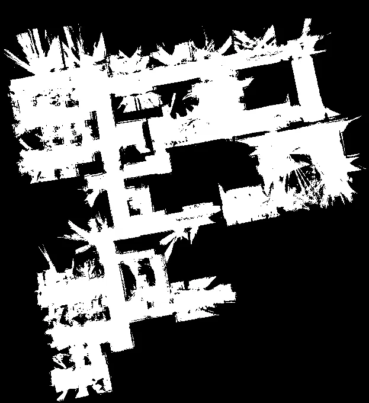

# EECE 5550 Mobile Robotics - Section 1

## Homework #4

**Due:** Nov 22, 2026 by midnight

---

## Problem 1: Route planning in occupancy grid maps

As we learned in our course, occupancy grid maps provide a convenient representation of a robot's environment that is particularly well-suited to route planning for navigation.

For example, Fig. 1a shows a probabilistic occupancy grid map of a research lab constructed using the [Cartographer](https://google-cartographer.readthedocs.io/) SLAM system, and Fig. 1b shows the corresponding binary occupancy grid map.

| (a) Probabilistic occupancy grid map | (b) Binary occupancy grid map |
| :---: | :---: |
| *(see HW4.pdf, page 1)* |  |

In this exercise, you will use $A^*$ search and implement a probabilistic roadmap (PRM) planner to find routes in the same environment. We will provide the binary occupancy grid map as an image file (`occupancy_map.png`). You can use Python's PIL and NumPy libraries to convert the image into a two-dimensional binary array $M$, where $M[r, c] = 0$ indicates an occupied cell and $M[r, c] = 1$ indicates a free cell. Each pixel corresponds to a grid cell $v = (r, c)$, identified by its row and column.

**Hint:** The following Python code can be used to obtain $M$ from the provided image:

```python
from PIL import Image
import numpy as np

img = Image.open("occupancy_map.png").convert("L")
M = (np.array(img) > 127).astype(int)
```

You may use existing implementations of graph-search algorithms; you are not required to implement $A^*$ from scratch.

### (a) Route planning in occupancy grids with $A^*$ search

Consider the free cells of $M$ as vertices of an 8-connected graph, where each cell is connected to its horizontally, vertically, and diagonally adjacent free cells. The cost of moving between two adjacent cells is the Euclidean distance between their centers.

1. **(i)** Implement a function $N(v)$ that returns the free neighboring cells of a given cell $v = (r, c)$, taking the map boundaries into account. Also implement a function $d(v_1, v_2)$ that computes the Euclidean distance between two cell centers.

2. **(ii)** Use an existing implementation of $A^*$ search to find a shortest path from $s = (635, 140)$ to $g = (350, 400)$. Use the Euclidean distance between cell centers as the edge cost for adjacent cells, and the Euclidean distance from each cell to the goal as the $A^*$ heuristic. Plot the path overlaid on the binary occupancy grid map, and report its total length (in grid-cell units).

> **Tip:** You may use a Python library for $A^*$ search, such as [NetworkX](https://networkx.org/documentation/stable/reference/algorithms/generated/networkx.algorithms.shortest_paths.astar.astar_path.html). You may also use another library that supports $A^*$ search directly on occupancy grids. If you use NetworkX, you will need to represent the grid as a graph; you do not need to implement the search algorithm itself.

### (b) Route planning with probabilistic roadmaps

Grid-based planning is convenient in low-dimensional spaces, but explicit grids become expensive as the dimension of the configuration space increases. Sampling-based planners provide an alternative by constructing a graph using sampled configurations rather than discretizing the entire space.

In this part, you will construct a *probabilistic roadmap* (PRM) for the same occupancy grid. The vertices of the roadmap are randomly sampled free cells from the configuration space $C$. Two vertices are connected by an edge if they are sufficiently close and the straight-line segment between their centers does not intersect any occupied cell. Use the Euclidean distance between the vertices as the edge weight. Algorithms 1 and 2 summarize this construction.

**Algorithm 1** Construction of a probabilistic roadmap

**Input:** Desired number of sample points $N$, maximum local search radius $d_{max}$.
**Output:** A graph $G = (V, E)$ consisting of a vertex set $V \subseteq C$ of cardinality $N$, and edge set $E$ indicating reachability via local control.

```text
1: function ConstructPRM(N, d_max)
2:     Initialize V = ∅, E = ∅.
3:     for k = 1, ..., N do
4:         Sample a new vertex v_new ∈ C.
5:         AddVertex(G, v_new, d_max)
6:     end for
7:     return G = (V, E)
8: end function
```

**Algorithm 2** Adding a vertex $v_{new}$ to the probabilistic roadmap $G = (V, E)$

```text
1: function AddVertex(G, v_new, d_max)
2:     V ← V ∪ {v_new}                                    ▷ Add vertex v_new to G
3:     for v ∈ V satisfying v ≠ v_new and d(v, v_new) ≤ d_max do
                                                         ▷ Link v_new to nearby vertices
4:         Attempt to plan a path from v_new to v.
5:         if planning succeeds then
6:             E ← E ∪ {(v, v_new)}                       ▷ Add edge e = (v, v_new) to G
7:         end if
8:     end for
9: end function
```

1. **(i)** Implement a function that samples a free cell $v = (r, c)$ uniformly at random from $M$.
   **Hint:** You may use rejection sampling or randomly select from a list of free cells.

2. **(ii)** We saw in class that it is easy to plan straight-line paths between arbitrary points using a differential drive robot, since the robot can rotate in-place to face the correct direction before beginning to move. Therefore, we might consider using a *straight-line path planner* as our local planner in line 4 of Alg. 2. Using this approach, a point $v_2 \in V$ is reachable from $v_1$ if and only if the line segment joining $v_1$ and $v_2$ does not intersect any occupied cells in $M$.

   Implement a function that performs this reachability check. Your function should accept as input the occupancy grid map $M$ and two grid cells $v_1 = (r_1, c_1)$ and $v_2 = (r_2, c_2)$, and return a Boolean value indicating whether the line segment joining $v_1$ and $v_2$ in $M$ is obstacle-free.

3. **(iii)** Using your sampling and collision-checking functions, implement the PRM construction described in Algorithms 1 and 2. You may use [NetworkX](https://networkx.org/) to store the roadmap and its edge weights.

4. **(iv)** Construct a PRM with $N = 2500$ samples and maximum connection radius $d_{max} = 75$ grid cells. Plot the roadmap overlaid on the occupancy grid map.

5. **(v)** Add the start $s = (635, 140)$ and goal $g = (350, 400)$ to the roadmap, connecting each to nearby vertices using the same distance and collision-checking rules. Use an existing shortest-path algorithm (e.g., NetworkX's [$A^*$ search](https://networkx.org/documentation/stable/reference/algorithms/generated/networkx.algorithms.shortest_paths.astar.astar_path.html)) to find a path from $s$ to $g$. Plot this path overlaid on the map, and report its total length. [Note: If $s$ and $g$ initially lie in separate connected components of $G$, you may need to sample and add more vertices to $G$ until $s$ and $g$ are path-connected.]

### (c) Comparison

Compare the path lengths obtained using grid-based $A^*$ search and PRM. Explain why the two methods may produce different paths. Briefly discuss how the number of PRM samples and the maximum connection radius could affect the resulting paths.

---

## Problem 2: Value iteration on MDP

Consider a Markov Decision Process where the set of states is the grid cells in Fig. 2(a), the action set contains $(up, right, left, down)$ actions, the transition probabilities for each action are modeled as in Fig. 2(b), and the rewards are located in the cells illustrated in Fig. 2(a).

- Note that any transition towards a wall will not incur a cost and the agent will stay in its current state as a consequence. For example, if the agent is in the bottom left corner and chooses the down action, it will stay in its current state with a probability of $1 - \frac{\epsilon}{2}$ (i.e., $1 - \epsilon\,(down) + \frac{\epsilon}{2}\,(left)$) and moves to the right cell with probability $\frac{\epsilon}{2}$.
- We will assume that the cells with rewards other than $-0.01$ are the terminal states.
- Also, assume that the discount factor is $\gamma = 0.9$.

Considering the cases where $\epsilon = 0.1$ and $\epsilon = 0.4$, use value iteration to find the optimal value function in each case and then compute the corresponding optimal policies. Plot each optimal policy on the environment with arrows indicating the optimal actions (as we saw in our lecture, slide 12 in Lecture 15). Discuss your observations on both policies.

**Figure 2(a):** The environment (rewards per cell)

|       |       |       |       |
| :---: | :---: | :---: | :---: |
| −0.01 | −0.01 | **−1** | **2** |
| −0.01 | −0.01 | −0.01 | −0.01 |
| **1** | −0.01 | −0.01 | −0.01 |
| −0.01 | −0.01 | −0.01 | −0.01 |

**Figure 2(b):** Transition probabilities under each action

| Action | Intended direction | Perpendicular directions |
| :--- | :--- | :--- |
| up | up with $1 - \epsilon$ | left with $\frac{\epsilon}{2}$, right with $\frac{\epsilon}{2}$ |
| down | down with $1 - \epsilon$ | left with $\frac{\epsilon}{2}$, right with $\frac{\epsilon}{2}$ |
| right | right with $1 - \epsilon$ | up with $\frac{\epsilon}{2}$, down with $\frac{\epsilon}{2}$ |
| left | left with $1 - \epsilon$ | up with $\frac{\epsilon}{2}$, down with $\frac{\epsilon}{2}$ |

*Figure 2: (a) An illustration of the environment, (b) An illustration of the transition probabilities under each action.*
